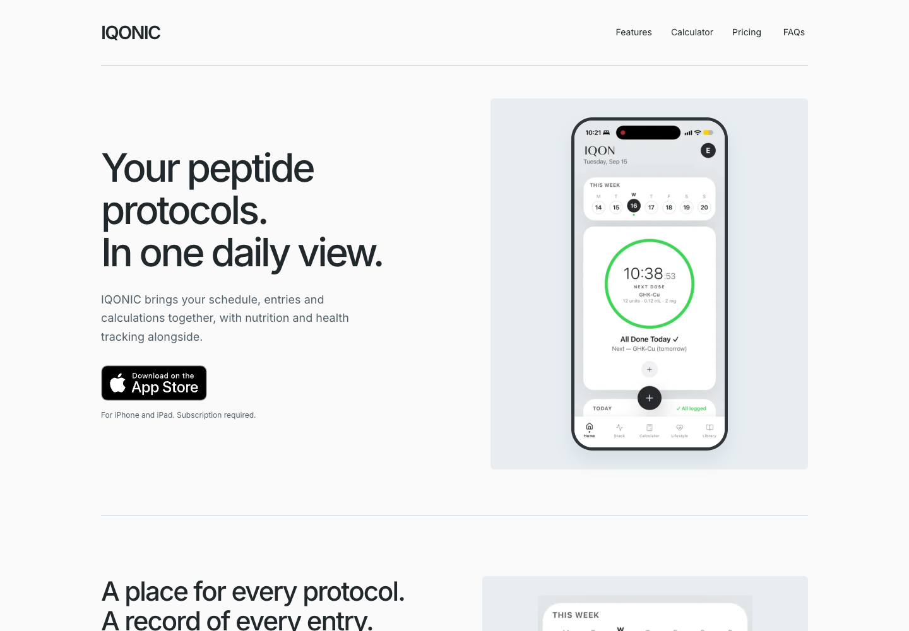
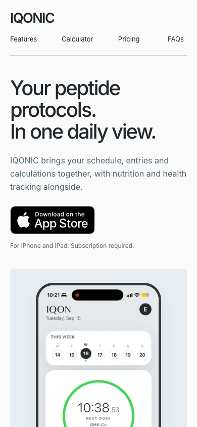

# IQONIC product-led redesign

The original homepage repeated its feature coverage across a scroll-driven hero, nine feature cards, tabs, an everyday section and setup steps. The desktop download badge overlapped the product screenshot. This change replaces that presentation with a stable split hero, real product evidence and three feature stories. The 390px page is 7,606px tall instead of 12,370px, a 38.5% reduction, while retaining the required feature coverage.

## Direction and alternatives

This is a Decide/Learn surface. Preserve IQONIC's light slate palette, Inter and wordmark. Establish the product and subscription requirement before the first download. Use screen captures as evidence, with typography and shared edges doing the structural work.

Two hero plus first-feature implementations were rendered at 1440×1000 and 390×844 before extending the page:

- **A, selected:** full device in a quiet slate field, text left, download beneath the description. A complete screen retains the app's navigation and context.
- **B, rejected:** larger hero screen cropped at the bottom, plus an editorial split section heading above a wide first-feature composition. It read cleanly but cut off useful product context and repeated another cropped screen below.

The final A moves the schedule detail before its explanatory rows on phones and uses a deliberate crop of the authentic screenshot. No production variants or toggles remain. Both alternatives, their source and screenshots are archived in the local evidence directory named below.

The saved-post research informed specific choices:

- [sitenley](https://x.com/sitenley/status/2116916615644057920): literal product definition, a consistent type system and actual product demonstrations. No BoardUI kit or artwork was copied or installed.
- [BrettFromDJ](https://x.com/BrettFromDJ/status/2117655774579310674): decide composition and compare rendered evidence before extending implementation. No Figma usage claimed.
- [OdemehC83598](https://x.com/OdemehC83598/status/2107454211365421268): make product, audience and purpose legible quickly. One hero CTA, without an extra logo block or slogan sequence.
- [maxwellfinn](https://x.com/maxwellfinn/status/2015878877067788512): retain critique and iteration evidence; the parent's independent final-head reviews remain required. These posts are design opinions, not conversion evidence.

## Screenshots





[Full desktop page](desktop-full.webp) · [Full phone page](phone-full.webp)

Full-resolution PNGs, both alternatives, baseline metrics, failing/passing logs and focus samples: `/Users/edorfanini/.hermes/workspace/iqonic-mobile/anti-slop/build`.

## Authentic assets

The source assets are unchanged files already tracked at baseline `ecaba1c`. Screens show the existing example account, not newly captured customer data. The Today, Nutrition and Lifestyle screenshots retain their proportions in understated frames. Two derivative WebPs use only source pixels, without invented UI:

- `schedule-detail.webp`: `iqonic-today.jpg`, Pillow crop `(24, 206, 576, 960)`, quality 92. Enlarges the week and completed-entry record without a partial status/header bar.
- `calculator-concentration.webp`: `calculator-original.png`, Pillow crop `(196, 1436, 1088, 2096)`, quality 92. Keeps the vial amount, water volume and concentration fields. The source promotional heading, medical-selection language and dosing suggestions are outside the crop.

No paid image generation, new app dependencies, shared browser installs or external assets were added.

## Behavior and scope

- Protocol schedules, entries/history and cycle lengths; concentration/volume and supply; vial inventory, spend and projections; meal/barcode/scan, calories/macros/water; menstrual cycle; Apple Health; research compound reference all remain accessible without feature tabs.
- Existing App Store ID `6765689488` and `hero`, `pricing`, `faq` event placements remain. Redundant header/feature/closing CTAs were removed with their sections. DNT and GPC continue suppressing analytics.
- Existing header anchors and all footer destinations remain. The navigation is visible on phones, so no menu or hydration flag is needed.
- Native `details`/`summary` FAQs preserve the shared FAQ source and schema, with keyboard behavior and no-JavaScript operation.
- Prices stay $8.99/month and $49.99/year with the existing October 12, 2026 US disclosure. No free tier or trial claim was added.
- Other route source, metadata/schema logic, legal text, redirects, App Store destination and exact Google verification bytes are unchanged. Removing the old FAQ noscript override is safe because native details works without scripts.
- Obsolete landing styles and the scroll-stage geometry test were replaced. `test:hero` now exercises the new layout and interactions. The SEO test's review-star assertion was replaced because reviews were intentionally omitted; pricing/FAQ/schema and other protections remain.

## Validation

```sh
NEXT_PUBLIC_SITE_URL=https://www.iqonicapp.com npm run build
npm run lint
npm run test:seo
PREVIEW_URL=http://127.0.0.1:4178 \
PLAYWRIGHT_MODULE=/Users/edorfanini/.hermes/hermes-agent/node_modules/playwright \
CHROME_PATH='/Applications/Google Chrome.app/Contents/MacOS/Google Chrome' \
HERO_EVIDENCE_DIR=/Users/edorfanini/.hermes/workspace/iqonic-mobile/anti-slop/build/final \
npm run test:hero
```

Build passes. Lint exits successfully with the pre-existing Fast Refresh warning in `src/components/ui/tabs.tsx`. SEO passes, including eight prerendered pages, H1/canonical/FAQ/schema parity, exact verification file, and personal-information guard.

The layout suite passes in 88 seconds: widths 320, 360, 390, 430, 768, 1024 and 1440; 390×700 also covered; each in normal and reduced motion. Checks cover hero copy/CTA/image separation, first-fold disclosure, overflow, all real images decoding, nav anchors, all FAQ keyboard open/close controls, sequential focus into FAQ links, exact App Store URLs, analytics, DNT/GPC, delayed-JavaScript first paint/hydration parity and no-JavaScript FAQ use. Browser errors: none.

Red/green: before edits, the desktop CTA-over-image assertion failed against the original homepage (`red-layout.log`); it passes on the new page. Pixel focus samples use the real download and FAQ backgrounds: minimum contrast 6.996:1 across 1,420 and 1,492 solid ring pixels. A 1.153:1 injected negative control was correctly rejected. Focus screenshots and the standalone local probe are in the evidence directory.

Measured with fonts loaded, FAQ closed, initial hero state and reduced motion. `body.innerText.trim().split(/\s+/)` counts visible text, excluding text inside image pixels and collapsed FAQ answers. At 390px, visible words fell from 854 to 457 (46.5%); height fell from 12,370 to 7,606px (38.5%). At 1440px, height fell from 12,659 to 5,231px, and visible words from 865 to 457. All core features remain in the page despite the shorter copy.

## Review and release handoff

Builder self-review: checked the exact diff, shared font preservation, image aspect ratios/crop boundaries, feature coverage, copy/pricing scope, native FAQ behavior, preserved links/analytics and unchanged route/verification files. Inspected full-page crops and narrow/tablet/desktop heroes. Source changes are confined to the homepage presentation and its verification.

No migrations or configuration/secrets changes. Rollback is a revert of this commit. No merge or deployment performed. Parent owns two independent exact-final-head reviews, corrections, release approval, production deployment and live verification. Local Chrome emulation is not physical iPhone/iPad Safari testing. No conversion improvement or current live deployment is claimed.
